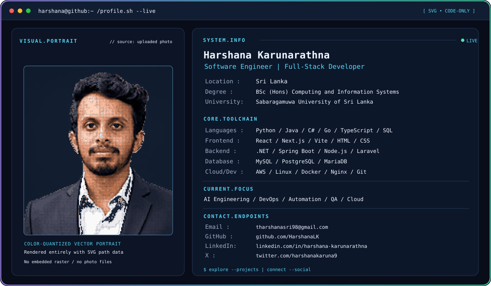

<!-- Harshana Karunarathna — GitHub profile, adapted from the uploaded terminal theme -->
<!-- Animated SVG portrait morphs into HK using SVG/SMIL; no embedded photo or JS. -->

<picture>
  <source media="(prefers-color-scheme: dark)" srcset="https://raw.githubusercontent.com/HarshanaLK/HarshanaLK/main/dark.svg" />
  <source media="(prefers-color-scheme: light)" srcset="https://raw.githubusercontent.com/HarshanaLK/HarshanaLK/main/light.svg" />
  
</picture>


<div align="center">

  <h3>Hi, I'm Harshana 👋</h3>

  <strong>Software Engineer • Full-Stack Developer • AI Engineering & DevOps Enthusiast</strong>

  <p>
    BSc (Hons) in Computing and Information Systems<br>
    Sabaragamuwa University of Sri Lanka
  </p>

  <p align="center">
    <a href="https://www.harshanakarunarathna.me"></a>&nbsp;&nbsp;&nbsp;
    <a href="https://www.linkedin.com/in/harshana-karunarathna/"></a>&nbsp;&nbsp;&nbsp;
    <a href="https://twitter.com/harshanakaruna9"></a>&nbsp;&nbsp;&nbsp;
    <a href="mailto:amtharshana@gmail.com"></a>
  </p>

</div>


## `$ ./projects.sh --featured`

<picture>
  <source media="(prefers-color-scheme: dark)" srcset="https://raw.githubusercontent.com/HarshanaLK/HarshanaLK/main/projects.svg" />
  <source media="(prefers-color-scheme: light)" srcset="https://raw.githubusercontent.com/HarshanaLK/HarshanaLK/main/projects-light.svg" />
  
</picture>

## `$ ./technologies.sh`

```text
LANGUAGES : Python · Java · C# · Go · TypeScript · JavaScript · SQL
FRONTEND  : React · Next.js · Vite · HTML · CSS
BACKEND   : .NET · Spring Boot · Node.js · Laravel · REST APIs
DATABASES : MySQL · PostgreSQL · MariaDB
DEVOPS    : AWS · Linux · Docker · Nginx · Git · CI/CD
INTERESTS : AI Engineering · Machine Learning · QA · Automation
```

## `$ ./github-activity.sh`


<!-- CONTRIBUTION SNAKE -->
<h2 align="center">🐍 My GitHub Contribution Snake</h2>

<picture>
  <source
    media="(prefers-color-scheme: dark)"
    srcset="https://raw.githubusercontent.com/HarshanaLK/HarshanaLK/output/snake-dark.svg"
  />
  <source
    media="(prefers-color-scheme: light)"
    srcset="https://raw.githubusercontent.com/HarshanaLK/HarshanaLK/output/snake-light.svg"
  />
  
</picture>


## `$ contact --open`


**Email:** [amtharshana@gmail.com](mailto:amtharshana@gmail.com)  
**Web:** [harshanakarunarathna.me](https://www.harshanakarunarathna.me)  
**LinkedIn:** [harshana-karunarathna](https://www.linkedin.com/in/harshana-karunarathna/)  
**GitHub:** [@HarshanaLK](https://github.com/HarshanaLK)


<!-- The hero includes a code-generated animated SVG pixel-morph portrait.
     See README_ANIMATION.md for installation and regeneration steps.
     Both hero and project cards are code-generated SVG vector graphics.
     GitHub needs an HTML  or Markdown image reference to display SVG files,
     but no PNG/JPG or raster image is embedded within these SVGs. -->
