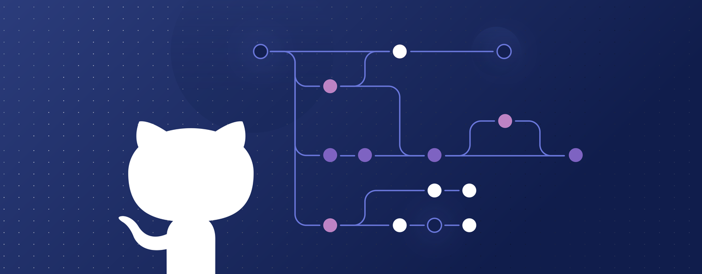
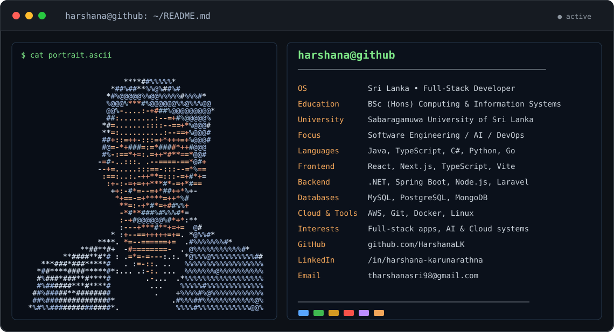

<!-- Harshana Karunarathna · GitHub profile README -->
<!-- This file belongs in the public HarshanaLK/HarshanaLK repository. -->

  

<h1 align="center">Hi, I'm Harshana Karunarathna 👋</h1>
<h3 align="center">Software Engineering · Full-Stack Development · AI Engineering · DevOps</h3>

  
  
  

<!-- This SVG is made of actual ASCII text characters rather than a raster photograph. -->

  

⌨️ View the portrait as real, copyable ASCII text

<pre>

                        ****##%%%%%*
                     *##%##**%%@%##%#
                    *#%@@@@@%%@@%%%%%#%%%#*
                    %@@@%***#%@@@@@@%%@%%%@@
                    @@%-....:-+###%@@@@@@@@@*
                    ##:........:--=+#%@@@@@%
                   *#=.......::::--==+*%@@@#
                   **=:..........:--==+%@@@#
                   ##+::=++-:::=+*+++=+%@@@#
                   #@=-*+###=:=*####*++#@@@
                   #%-:==*+=:.=++*#**==*@@#
                  -=#-..:::. .--====-==*@#+
                  --+=.....:::==-:::--=*%==
                   :==:..:.-++**=:::-=+#*+=
                    :+-:-=+=++***#*-=+*#==
                     ++:-#*=--=+*##++*%+-
                      *+==-=+****=++*%#
                       **=:-+*#*=+##%%+
                       -*#**###%#%%%#*=
                       :-+#@@@@@@%#*+*:**
                       :---+***#**+=+=  @#
                     * :+--==+++++=+=. *@%%#*
                  ****. *=--======+=  .#%%%%%%%#*
              **##**#+  -#========-  . @%%%%%%%%%%%#*
          **####**#*# : .=*=-=---:.:. *@%%%@%%%%%%%%%%##
     ***###*###*****#   . :=-::. ..   %%%%%%%%%%%%%%%%%%
    *##****####*****#*:... .:-:. ...  %%%%%%%@%%%%%%%%%%
    #%###*###**#****#        .-...  .*%%%%%%%%%%%%%%%%%%
    #%######***#****#         ...    %%%%%#%%%%%%%%%%%%%
   ##%#####**########          .    +%%%%#%@%%%%%%%%%%%%
   ##%###############*             .#%%%##%%%%%%%%%%%%@%
  *%#%%##############*.             %%%%#%%%%%%%%%%%%@@%
</pre>

### 👨‍💻 About me

I'm a computing and information systems graduate from **Sabaragamuwa University of Sri Lanka**, passionate about developing useful, reliable software. My interests include full-stack development, cloud engineering, AI applications, and DevOps.

- 🛠️ I enjoy building production-ready applications and working across frontend, backend, and infrastructure.
- 🧠 I explore AI/ML, automation, and software engineering research.
- 📫 **Reach me:** [tharshanasri98@gmail.com](mailto:tharshanasri98@gmail.com)
- 🔗 **Connect:** [LinkedIn](https://www.linkedin.com/in/harshana-karunarathna/) · [X / Twitter](https://twitter.com/harshanakaruna9)

### 🧰 Technologies

**Languages:**

**Frameworks & platforms:**

### 📌 Selected work

| Project | Highlights |
| :--- | :--- |
| [**LeaveHub – Employee Leave Management System**](https://github.com/HarshanaLK/leave-management) | React, TypeScript, Spring Boot, MySQL, secure authentication, leave approval workflows |
| [**Learning Management System**](https://github.com/HarshanaLK/learning-management-system) | Learning platform, full-stack web development, deployment |
| [**Event-driven Enterprise Commerce**](https://github.com/HarshanaLK/event-driven-enterprise-commerce) | Event-driven architecture and enterprise application design |

### 📊 GitHub activity

  
  

Statistics cards rely on an external service and might occasionally fail to display. Counts are not hard-coded.

---

<em>Thanks for visiting — explore my repositories and feel free to connect.</em>

