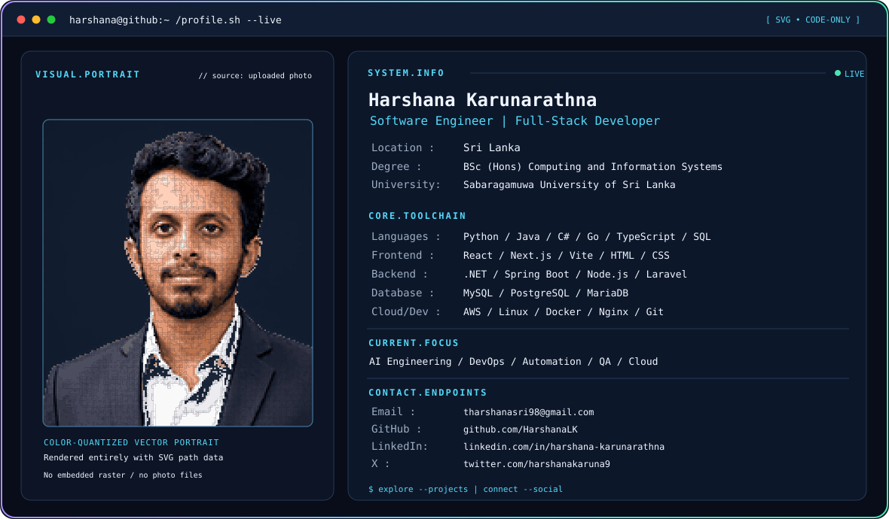

# Animated SVG portrait — HarshanaLK

This update makes the **existing portrait** animate similarly to the Shahzaib-Malik77 SVG pixel-morph design while preserving Harshana's colours, text, contact information, and GitHub README layout.

## Animation cycle

1. Your original full-colour, vector-only portrait appears.
2. The photo fades into approximately 1,500 neon pixels.
3. Each pixel moves independently and forms **HK / HARSHANA**.
4. Pixels flow back into the portrait shape.
5. The original colour portrait fades back in and the 15-second loop repeats.

The effect is **SVG SMIL** (`<animate>` and `<animateTransform>`), not a GIF, JavaScript, CSS background, or an embedded JPEG/PNG. Dark and light SVG versions are both included.

## Install it on your GitHub profile

Copy the modified files to your `HarshanaLK/HarshanaLK` repository, keeping the existing README's `<picture>` element:

```html
<picture>
  <source media="(prefers-color-scheme: dark)" srcset="https://raw.githubusercontent.com/HarshanaLK/HarshanaLK/main/dark.svg" />
  <source media="(prefers-color-scheme: light)" srcset="https://raw.githubusercontent.com/HarshanaLK/HarshanaLK/main/light.svg" />
  
</picture>
```

Commit and push:

```sh
git add README.md dark.svg light.svg animated_portrait.py generate_profile.py README_ANIMATION.md preview.html
git commit -m "Add animated pixel-morph profile portrait"
git push origin main
```

Your local `preview.html` can also display both images. Open `dark.svg` directly in Chrome or Firefox to see the loop.

## Regenerate the animation from the existing SVG files

The original photo file is **not required** because the source portrait is stored as coloured vector paths inside `dark.svg` and `light.svg`.

```sh
python -m pip install -r requirements.txt
python animated_portrait.py
```

Change the loop length or density:

```sh
python animated_portrait.py --cycle 12 --density 3
python animated_portrait.py --cycle 16 --density 4
```

`--density 2` adds finer, more numerous animated squares. `--density 4` creates fewer squares and smaller SVGs. Running the script again is safe: it replaces the old pixel layer instead of duplicating it.

## If you want to use a new portrait photograph

```sh
python generate_profile.py --photo your-portrait.jpg
```

`generate_profile.py` still creates your original colour-vector portrait from the photo, and now automatically adds the animated pixel morph to both theme files.

## Troubleshooting

- The animation should work in modern browsers that support SVG SMIL. GitHub or a particular app's preview may display a still image, and reduced-motion settings may affect animations.
- When viewing your GitHub README, refresh the page after pushing updates; GitHub's image caching can temporarily show the previous version.
- Do **not** upload the static PNG previews instead of `dark.svg` and `light.svg`; PNG files cannot play the SVG animation.
- Keep both the `<picture>` sources pointing at the animated `.svg` assets.
